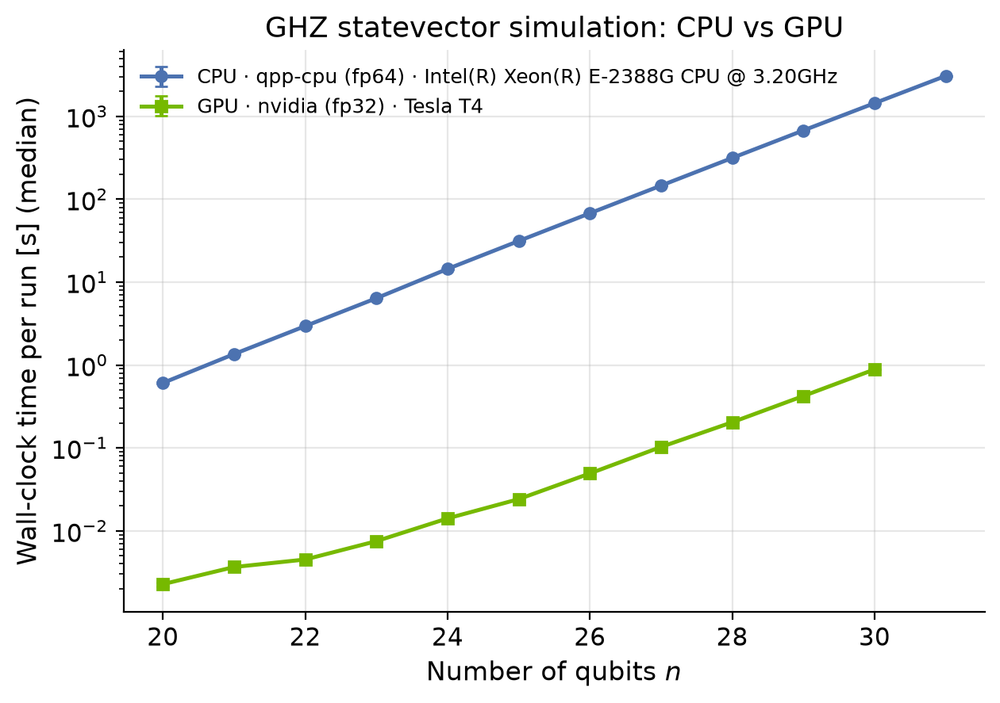
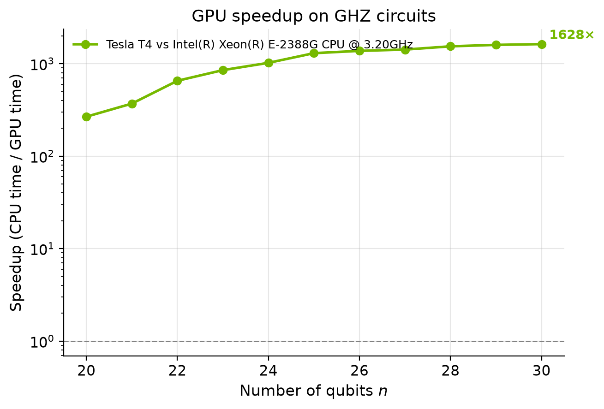
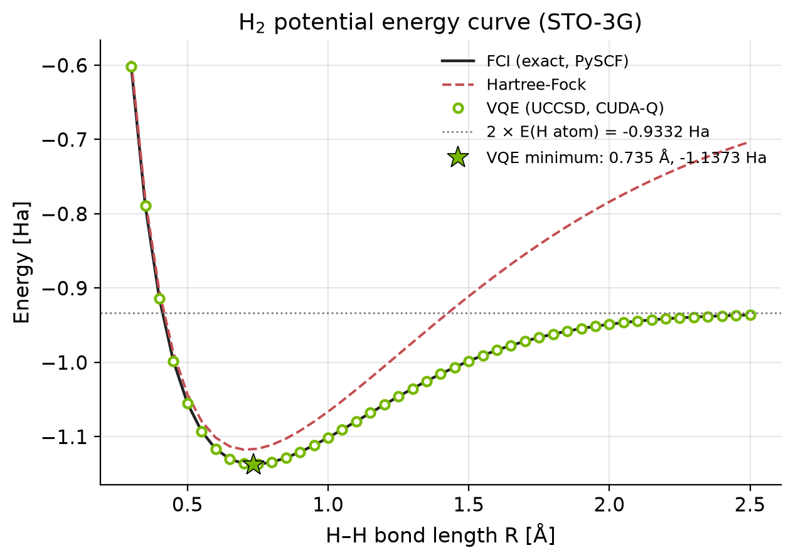
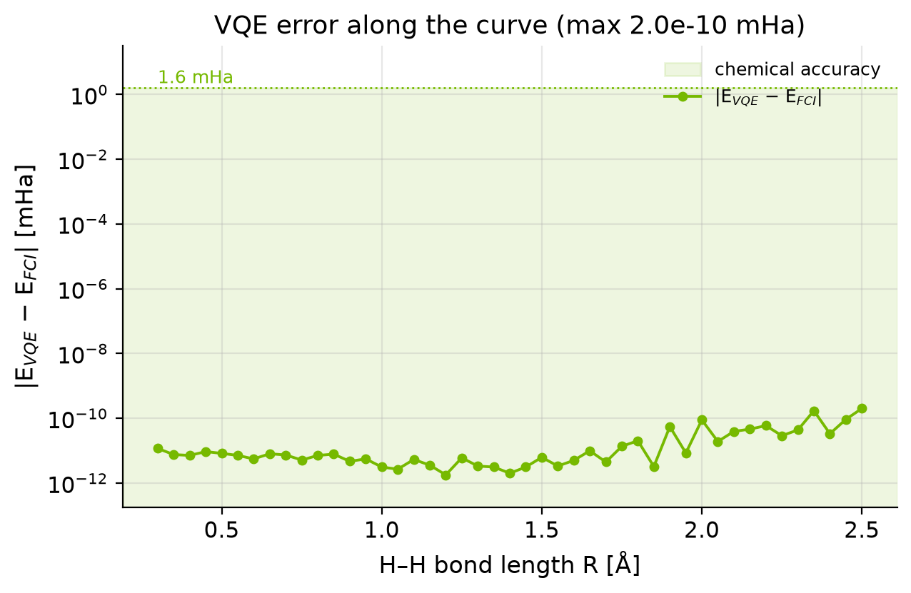
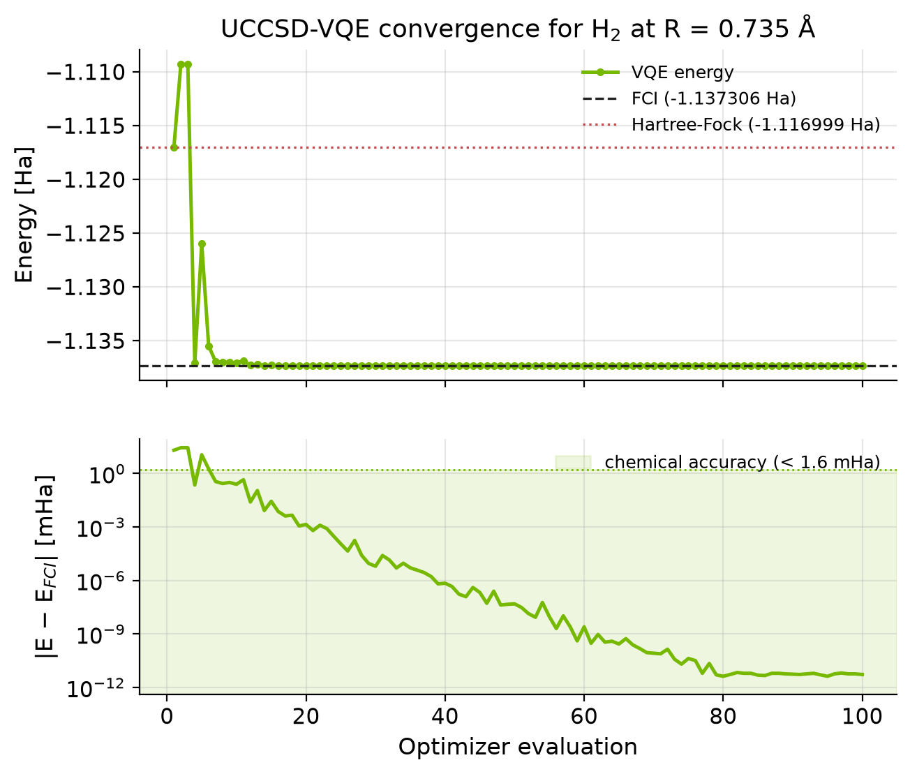

<!-- Generated by scripts/build_readme.py from results/. Edit docs/README.template.md instead. -->
# gpu-quantum-sim

**GPU-accelerated quantum simulation and quantum chemistry with NVIDIA CUDA-Q**

[](https://colab.research.google.com/github/8kk24g7bgc-coder/gpu-quantum-sim/blob/main/notebooks/colab_quickstart.ipynb)


**[Live demo](https://8kk24g7bgc-coder.github.io/gpu-quantum-sim/)**: explore the memory wall, build a GHZ state gate by gate, and find the H₂ ground state yourself, all in the browser and on the measured data.

This project measures how much a GPU speeds up quantum-circuit simulation, then uses the same simulator for a real chemistry problem. Statevector simulation of GHZ circuits reached **31 qubits** (a 32 GiB state on the CPU), and on an NVIDIA Tesla T4 the cuStateVec backend was **1,628× faster** than an 8-core Intel Xeon E-2388G at 30 qubits (0.885 s instead of 24.0 min). A variational quantum eigensolver (VQE) with a UCCSD ansatz reproduces the H₂ potential energy curve at 45 bond lengths with a **maximum error of 2.0 × 10⁻¹⁰ mHa** against exact full configuration interaction (FCI), well inside chemical accuracy (1.6 mHa), and places the equilibrium at 0.735 Å and −1.1373 Ha. Every number on this page is computed from the files in [`results/`](results/) by [`scripts/build_readme.py`](scripts/build_readme.py).

## Key results

| GHZ benchmark | CPU: `qpp-cpu` (fp64) | GPU: `nvidia` / cuStateVec (fp32) |
|---|---|---|
| Hardware | Intel Xeon E-2388G, 8 cores, 125 GiB RAM | NVIDIA Tesla T4, 15 GiB |
| Largest system simulated | **31 qubits** (32 GiB state) | **30 qubits** (8 GiB state) |
| Time per run at 30 qubits | 24.0 min | 0.885 s |
| GPU speedup | 267× at 20 qubits | **1,628× at 30 qubits** |

| H₂ / STO-3G, UCCSD-VQE | Value |
|---|---|
| Qubits / Pauli terms / UCCSD parameters | 4 / 15 / 3 |
| Bond lengths scanned | 45 (0.30–2.50 Å, step 0.05 Å) |
| Equilibrium found by VQE | R = 0.735 Å, E = −1.1373 Ha (FCI there: −1.1373 Ha) |
| Max \|E<sub>VQE</sub> − E<sub>FCI</sub>\| over the curve | **2.0 × 10⁻¹⁰ mHa** (9 orders of magnitude below 1.6 mHa) |

## Plots

| | |
|---|---|
|  |  |
|  |  |



## Why this is hard

A classical computer stores an *n*-qubit state as 2<sup>*n*</sup> complex amplitudes: 8 bytes each in single precision, 16 in double. Every extra qubit **doubles the memory**, and every gate has to **touch every amplitude**, so the runtime doubles too. That is exactly the slope of the runtime plot: about ×2 per qubit on both devices.

Both devices hit the same wall, at different heights. At 31 qubits the CPU state is already 32 GiB; 32 qubits (64 GiB, plus about the same again in simulator workspace) no longer fit in the 125 GiB node, and the run was stopped by the out-of-memory killer ([log](docs/ghz_cpu_n24_job51371.log)). The 15 GiB GPU stops at 30 qubits for the same reason.

Large statevectors are limited by memory bandwidth rather than arithmetic, and a GPU has far more of it. That is why the speedup grows from 267× at 20 qubits, where fixed launch and Python overheads dominate, to about 1,628× once the state is large.

## How VQE works

1. **Molecule → Hamiltonian.** PySCF and OpenFermion build the electronic Hamiltonian of H₂ in the STO-3G basis (via `cudaq.chemistry.create_molecular_hamiltonian`), and the Jordan-Wigner mapping turns its 4 spin orbitals into **4 qubits** and **15 Pauli terms** (including the identity).
2. **Hamiltonian → circuit.** The circuit starts from the Hartree-Fock state |1100⟩ and applies the UCCSD ansatz from `cudaq.kernels.uccsd`, which has **3 parameters** for 2 electrons in 4 spin orbitals.
3. **Circuit → energy.** `cudaq.observe` returns the expectation value ⟨ψ(θ)|H|ψ(θ)⟩.
4. **Classical optimizer loop.** SciPy's COBYLA updates θ until the energy stops decreasing. Along the bond-length scan, each point starts from the previous optimum (warm start).

The result is checked against classical references from PySCF: Hartree-Fock (which misses the correlation energy and fails at dissociation) and exact FCI. The tests also diagonalise the 16×16 qubit Hamiltonian directly, to confirm that the qubit mapping reproduces FCI. At large bond lengths the curve approaches the dissociation limit 2 × E(H atom) = −0.9332 Ha.

## Hardware used

| Run | Machine | Details |
|---|---|---|
| GHZ, CPU | HPC cluster node `n24` (Slurm) | Intel Xeon E-2388G, 8 physical cores (8 OpenMP threads), 125 GiB RAM |
| GHZ, GPU | Google Colab (free tier) | NVIDIA Tesla T4 (15 GiB), host CPU Intel Xeon |
| H₂ VQE | HPC cluster node `n21` (CPU) | `qpp-cpu` target, full scan in 2.9 min |

Software: CUDA-Q 0.16.0; all package versions are pinned in [`requirements.txt`](requirements.txt). Each benchmark writes a `*_hardware.json` file next to its CSV with the exact machine, library versions and git commit.

Method: 5 timed runs per qubit count after one warm-up; the median wall-clock time of a `cudaq.sample` call with 1000 shots is reported, with the standard deviation as error bars.

## How to reproduce

```bash
git clone https://github.com/8kk24g7bgc-coder/gpu-quantum-sim.git
cd gpu-quantum-sim
make install            # pinned dependencies
make test               # unit and integration tests
make quick              # reduced GHZ and VQE runs, each under 2 minutes on a CPU
make ghz GHZ_TAG=mine   # full GHZ benchmark on this machine -> results/ghz_benchmark_mine.csv
make vqe                # full H2 scan, a few minutes on a CPU
make plots readme       # merge all GHZ CSVs, redraw every plot, regenerate this README
make viz                # rebuild the interactive demo page (docs/index.html)
```

- **No GPU?** Open the [Colab notebook](notebooks/colab_quickstart.ipynb) on a free T4. On a machine without a GPU, the GPU part is skipped with a message and everything else still runs.
- **No `make`?** Use `./run_all.sh` (or `./run_all.sh --quick`), which runs the same steps.
- **Slurm cluster:** [`cluster/sbatch_ghz_cpu_n24.sh`](cluster/sbatch_ghz_cpu_n24.sh) is the job script used for the CPU benchmark.

## Repository layout

```
src/hardware.py        hardware detection, statevector memory estimator
src/ghz_benchmark.py   GHZ kernel, correctness check, CPU/GPU benchmark
src/h2_vqe.py          H2 Hamiltonian, UCCSD-VQE, potential energy curve
src/plotting.py        all figures, regenerated from the result files
scripts/build_readme.py  fills this README from results/
tests/                 pytest suite (GHZ, memory model, VQE vs FCI, plots)
results/               raw CSV/JSON results and figures
notebooks/             Colab quickstart (calls the same commands as the Makefile)
cluster/               Slurm job script
```

## Limitations

- **This is classical simulation.** It shows how fast a GPU can emulate a quantum computer, not a quantum advantage. The exponential memory wall described above is the reason real quantum hardware is interesting.
- **H₂ is small enough to solve exactly.** With 2 electrons, UCCSD can represent the exact ground state, so the VQE error is set by the optimizer tolerance, not by the method. H₂ is a correctness check, not a hard chemistry problem.
- **The speedup depends on the hardware and the setup.** The two devices are on different machines; the CPU simulator (`qpp-cpu`) runs in double precision and the GPU (cuStateVec) in single precision, as in each target's default configuration; and `qpp-cpu` is not the fastest CPU simulator available. Timings include Python and sampling overhead. A different CPU, GPU or simulator will give a different factor.
- **GHZ is a shallow circuit** (*n* gates). Deeper circuits shift the balance between per-gate cost and fixed overhead.

## Résumé bullet

> Benchmarked statevector simulation up to 31 qubits with NVIDIA CUDA-Q; the cuStateVec GPU backend ran 1,628× faster than an 8-core CPU at 30 qubits. VQE with a UCCSD ansatz reproduces the H₂ potential energy curve within 2.0 × 10⁻¹⁰ mHa of FCI (chemical accuracy).
